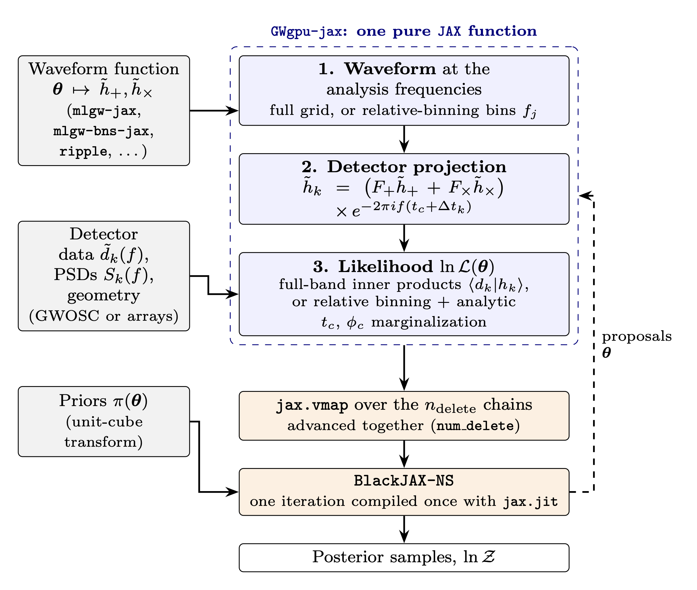

# GWgpu-jax

**Author:** Saulo Albuquerque ([ORCID 0000-0003-2911-9358](https://orcid.org/0000-0003-2911-9358)) — see [Author](#author).

GWgpu-jax provides a user-friendly interface between JAX waveform generators, mainly the Machine Learning Surrogates (MLGW), and JAX sampling algorithms for GPU-accelerated parameter estimation in gravitational wave data analysis. It supplies JAX likelihoods, detector-network construction, and real-data import pipelines.

## How it works

<p align="center">
  
</p>

GWgpu-jax is an integration layer: it does not implement waveform models or samplers itself. You
supply any JAX function that returns the two polarisations, and GWgpu-jax combines it with the
detector data, PSDs and geometry into a single pure-JAX log-likelihood, either over the full
frequency grid or with relative binning and analytic marginalisation over the coalescence time and
phase. The likelihood is vectorised with `jax.vmap` over the `num_delete` chains that the nested
sampler advances together, so memory scales with `num_delete` rather than with the number of live
points, and each sampler iteration is compiled once with `jax.jit`.
(Diagram source: [`docs/architecture.tex`](docs/architecture.tex).)

## Waveform generators

| Generator | Model | Domain | Source type | Reference |
|---|---|---|---|---|
| [ripplegw](https://github.com/tedwards2412/ripple) | IMRPhenomD | frequency | BBH | [Phys.Rev.D 106 (2022)](https://journals.aps.org/prd/abstract/10.1103/PhysRevD.106.044029) |
| mlgw_bns_jax | MLGW-BNS_TEOBResumSPA | frequency | BNS | [Phys. Rev. D 107 (2023)](https://journals.aps.org/prd/abstract/10.1103/PhysRevD.107.084037) |
| mlgw_bbh_jax | mlgw_SEOBNRv5HM (model_4) | time | BBH | [Phys.Rev.D 103 (2021)](https://journals.aps.org/prd/abstract/10.1103/PhysRevD.103.043020) |

mlgw_bns_jax and mlgw_bbh_jax live under `gwgpu_jax/mlgw_jax/` and are loaded via `sys.path` — no separate pip install is required.

`mlgw_bbh_jax` is a **git submodule** pointing at the `gwgpu_jax_compatible`
branch of [adrianomascioli/MLGW-JAX](https://github.com/adrianomascioli/MLGW-JAX)
(a fork of [stefanoschmidt1995/MLGW](https://github.com/stefanoschmidt1995/MLGW)),
so it is not stored in this repository. Clone with `--recurse-submodules`, or
run `git submodule update --init` in an existing checkout; otherwise the
directory is empty and the mlgw_bbh waveform will not import.

## Sampler

This branch uses the **acceptance-walk** nested-sampling kernel of
[Prathaban et al. (2025)](https://arxiv.org/abs/2509.04336) — the
`bilby`/`dynesty` constrained random-walk move that is the LIGO/Virgo community
standard, ported to GPU inside the
[blackjax-ns](https://github.com/handley-lab/blackjax) framework and shown there
to recover posteriors and evidences **statistically identical** to the CPU
`bilby` pipeline for aligned-spin binary black holes. We use it here because,
unlike a generic sampler, it is a nested-sampling kernel already **validated on
gravitational-wave data** — the results are defensible to a PE-specialist
audience while your own gwgpu_jax likelihood, waveform, network, and priors are
used unchanged.

The driver is `gwgpu_jax.GWgpu_jaxAcceptanceWalkSampler` (see
[`ACCEPTANCE_WALK.md`](ACCEPTANCE_WALK.md)). It runs on:

- **blackjax-ns**, pinned to commit `dedbf11da33eb5ca286f6731e2c51f2b254b953f`
  (**do not upgrade** — the `PartitionedState` API was removed in later commits;
  the acceptance-walk kernel depends on it);
- the **acceptance-walk kernel** itself, which lives in a separate,
  separately-licensed repository
  ([`mrosep/blackjax_ns_gw`](https://github.com/mrosep/blackjax_ns_gw)) and is
  **not bundled** with gwgpu_jax. Fetch it once (see below); it pins the *same*
  blackjax commit, so there is no version conflict.

### Fetching the acceptance-walk kernel

```bash
bash scripts/fetch_acceptance_walk_kernel.sh
```

This sparse-clones only the `custom_kernels` package into `external/`
(git-ignored — the kernel is never copied into this repo). gwgpu_jax discovers
it automatically at `external/blackjax_ns_gw/src`, or set
`GWJAX_ACCEPTANCE_WALK_SRC` to point at any checkout of its `src/` directory.

**Cite** Prathaban et al. (2025, arXiv:2509.04336) and Cabezas et al. (2024,
arXiv:2402.10797) if you use this sampler.

## Installation

### Requirements

- **Python 3.11 or 3.12** — the `mlgw` extra installs TensorFlow < 2.16 (Keras 2)
  on 3.11 and TensorFlow ≥ 2.16 (Keras 3) on 3.12 (current Google Colab); both give
  bit-identical mlgw waveforms. Python 3.13 is not supported.
- **JAX ≥ 0.4.31** (no upper bound; checked with 0.4.31, 0.4.38, 0.5.2 and 0.12). `jax`, `jaxlib`
  and the CUDA plugin must come from the same release. On Google Colab use the image's own jax —
  the Colab notebooks keep it, freeze it with a pip constraints file before installing gwgpu_jax,
  and check the mlgw waveforms against reference values (`examples/referee_response/waveform_reference/`)
  before sampling.
- Git

### Install from GitHub (pip — recommended)

```bash
# CPU only (laptops, macOS, plain Linux)
pip install "gwgpu_jax @ git+https://github.com/saulo-albuquerque-phys/GWgpu-jax.git"

# + real-data ingest (gwpy + GWOSC)
pip install "gwgpu_jax[data] @ git+https://github.com/saulo-albuquerque-phys/GWgpu-jax.git"

# + NVIDIA GPU (CUDA 12)
pip install "gwgpu_jax[gpu,data] @ git+https://github.com/saulo-albuquerque-phys/GWgpu-jax.git"

# + heavy ML waveform models (TensorFlow + tf2jax for SEOBNRv5HM / mlgw_bns_jax)
pip install "gwgpu_jax[mlgw,data] @ git+https://github.com/saulo-albuquerque-phys/GWgpu-jax.git"
```

> pip initialises git submodules automatically, so `mlgw_bbh_jax` is fetched
> as part of any of the commands above — no extra step is needed. Note that
> this makes the *install* download large (the MLGW-JAX repository carries
> several hundred MB of paper figures), even though the installed package
> itself excludes them.

### Google Colab quickstart (GPU runtime)

Colab GPU runtimes ship with a CUDA-enabled JAX, so the `gpu` extra is **not**
needed. The repository is public — no token or authentication step is required.

```python
!pip install -q "gwgpu_jax[data] @ git+https://github.com/saulo-albuquerque-phys/GWgpu-jax.git"

import jax, gwgpu_jax
print(jax.devices())                       # → [CudaDevice(id=0), …]
grid = gwgpu_jax.TimeFrequencyGrid(4.0, 2048.0, f_min=20.0, f_max=512.0)
net  = gwgpu_jax.Network.from_names(["H1", "L1"], grid)
gwgpu_jax.compat.attach_event_to_network(net, "GW150914", estimate_psd=True)
```

The full ready-to-run version is in [`examples/gwgpu_jax_colab_pe.ipynb`](examples/gwgpu_jax_colab_pe.ipynb).

### Editable local install (development)

```bash
git clone --recurse-submodules https://github.com/saulo-albuquerque-phys/GWgpu-jax.git
cd GWgpu-jax
pip install -e ".[data,mlgw,samplers]"     # all extras except [gpu]
```

If you already cloned without `--recurse-submodules`:

```bash
git submodule update --init
```

### Bash setup scripts

The `setup_env_*.sh` scripts build pinned, reproducible environments — useful
when you need to match an exact JAX / TF / blackjax combination.

### Full environment — all three waveforms + blackjax-ns (recommended for the ML models)

```bash
bash setup_env_full.sh           # creates ./venv_full by default
source venv_full/bin/activate
```

This installs **ripplegw + mlgw_bns_jax + mlgw_bbh_jax + blackjax-ns together**
(TensorFlow 2.15, jax 0.4.31, numpy 1.26.4; see `requirements-full.txt` for the
full pinned lock) and runs the smoke test below to confirm all four coexist in
one process. Verified from a clean build. The hard ceilings are `jax < 0.5`
(blackjax-ns fork) and `tensorflow < 2.16` (2.16 switched to Keras 3, which
breaks the mlgw_bbh loader).

### Acceptance-walk environment (this branch's sampler) — recommended

```bash
bash setup_env_acceptance_walk.sh    # builds ./venv_full, then fetches the kernel
source venv_full/bin/activate
```

This runs `setup_env_full.sh` (all three waveforms + pinned blackjax-ns) and then
`scripts/fetch_acceptance_walk_kernel.sh` to pull the external acceptance-walk
kernel into `external/` (git-ignored). After it finishes you can run the
acceptance-walk notebooks/examples directly. On Google Colab the notebooks do
the equivalent install + kernel fetch in their first cells — no local setup
needed.

### CPU-only environment (ripplegw + blackjax-ns only)

```bash
bash setup_env_cpu.sh            # creates ./venv by default
source venv/bin/activate
```

### CUDA 12 environment

```bash
bash setup_env_cuda.sh           # creates ./venv_cuda by default
source venv_cuda/bin/activate
```

### Manual setup

```bash
python3.11 -m venv venv_full
source venv_full/bin/activate
pip install --upgrade pip

# JAX (CPU)
pip install "jax[cpu]==0.4.31" "jaxlib==0.4.31"

# Pinned blackjax nested-sampling fork
pip install "blackjax @ git+https://github.com/handley-lab/blackjax.git@dedbf11da33eb5ca286f6731e2c51f2b254b953f"

# TensorFlow 2.15 + tf2jax (required for mlgw_bbh_jax / mlgw_bns_jax).
# Must stay < 2.16 — TF 2.16 ships Keras 3 and breaks the mlgw_bbh loader.
pip install "tensorflow==2.15.1" "tf2jax==0.3.6"

# Pin numpy (JAX 0.4.31 needs >=1.22; TF 2.15 accepts <2.0, so 1.26.4 fits both)
pip install "numpy==1.26.4"

# Remaining dependencies
pip install -r requirements-full.txt

# GWgpu_jax in editable mode
pip install -e .
```

### Verifying the installation

```bash
python tests/test_all_waveforms.py
```

Expected output (TensorFlow/JAX log lines omitted):

```
============================================================
1. ripplegw  |  IMRPhenomD  |  frequency-domain  |  BBH
============================================================
  hp shape : (4096,)   hc shape : (4096,)   STATUS : OK

============================================================
2. mlgw_bns_jax  |  ML-BNS  |  frequency-domain  |  BNS
============================================================
  hp shape : (2048,)   hc shape : (2048,)   STATUS : OK

============================================================
3. mlgw_bbh_jax  |  SEOBNRv5HM  |  time-domain  |  BBH
============================================================
  hp shape : (8192,)   hc shape : (8192,)   STATUS : OK

============================================================
4. blackjax-ns  |  nested sampling  |  sampler
============================================================
  version  : 0.1.dev707+gdedbf11da   STATUS : OK

============================================================
ALL FOUR COMPONENTS WORKING IN THE SAME ENVIRONMENT
============================================================
```

### GPU memory (CUDA only)

```bash
export XLA_PYTHON_CLIENT_MEM_FRACTION=0.8   # use 80 % of GPU memory
```

## Author

GWgpu-jax was created and is maintained by **Saulo Albuquerque** (Saulo Soares de Albuquerque Filho,
[ORCID 0000-0003-2911-9358](https://orcid.org/0000-0003-2911-9358)). The code was developed with the
assistance of [Claude](https://www.anthropic.com/claude), Anthropic's AI model, used through Claude Code.

The waveform surrogates it interfaces with are the work of their own authors: mlgw / MLGW-JAX
(S. Schmidt, A. Frattale Mascioli and collaborators) and mlgw_bns (J. Tissino); see the table above and
the License section.

## License

GWgpu-jax is released under the **GNU General Public License v3.0 or later**
(see [`LICENSE`](LICENSE)). GPL-3 applies because this repository bundles and
modifies [mlgw_bns](https://github.com/jacopok/mlgw_bns) (GPL-3, Jacopo
Tissino) under `gwgpu_jax/mlgw_jax/mlgw_bns_jax/`, which makes the combined
work a derivative.

Bundled and referenced components keep their own licenses:

| Component | Location | License |
|---|---|---|
| mlgw_bns | `gwgpu_jax/mlgw_jax/mlgw_bns_jax/` (bundled, modified) | GPL-3 |
| MLGW-JAX (mlgw_bbh) | git submodule — not redistributed here | no license stated upstream |
| acceptance-walk kernel | fetched into `external/` — not bundled | see [`mrosep/blackjax_ns_gw`](https://github.com/mrosep/blackjax_ns_gw) |

Note that [MLGW-JAX](https://github.com/adrianomascioli/MLGW-JAX) and its parent
[MLGW](https://github.com/stefanoschmidt1995/MLGW) do not currently state a
license, which means default copyright applies to them. It is referenced as a
submodule rather than copied here, so using GWgpu-jax does not redistribute it —
but if you intend to reuse that code yourself, contact its authors first.

## mlgw_bbh_jax — notes on model loading

The mlgw_bbh_jax models are saved in Keras 3.x `.keras` format.  
The bundled `NN_model.py` has been patched to load them in a Keras 2.x environment (Keras 2.15, which ships with TF 2.15) by parsing the layer specs directly rather than calling `from_config`.  
The active model is **model_4** (SEOBNRv5HM, modes 22 21 32 33 43 44 55, $q \in [1,10]$, $\chi_{1,2} \in [-0.9, 0.9]$).

